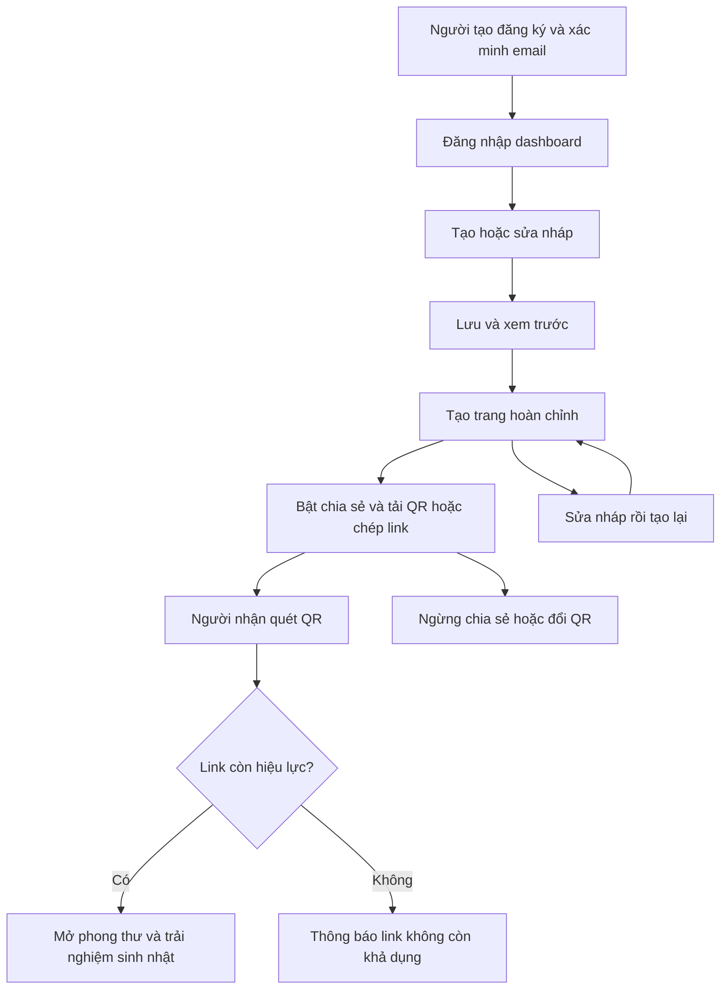

# Phân tích luồng: người tạo quản lý, người nhận quét QR xem

Phiên bản 0.2. Đây là đặc tả đề xuất, chưa triển khai mã ứng dụng. Yêu cầu mới thay thế giả định v0.1 rằng chỉ chủ sở hữu được xem.

## 1. Mô hình hoạt động

Người tạo có tài khoản để tạo và sửa trang. Người nhận không cần tài khoản: quét QR hoặc bấm link để xem bản người tạo đã hoàn tất. Chỉ tài khoản chủ sở hữu được sửa/xóa/tạo lại hay quản lý QR.

QR là cách biểu diễn một liên kết có quyền xem. Ai có QR/link đều mở được và có thể chuyển tiếp. MVP không chứng minh người quét chính là người được ghi tên trong lời chúc. Nếu cần xác minh đúng người, bổ sung PIN/OTP sau; không đưa bước đó vào luồng hiện tại.

## 2. Luồng người tạo

### F-01 — Đăng ký và vào hệ thống

1. Nhập email, mật khẩu, xác nhận mật khẩu; hoàn thành CAPTCHA.
2. Backend kiểm tra CAPTCHA, dữ liệu và hạn mức rồi tạo tài khoản pending, gửi email xác minh.
3. Người dùng xác minh và đăng nhập; dashboard chưa có trang hiển thị “Tạo trang sinh nhật”. Tài khoản cũ vào thẳng trang của mình.
4. Dashboard thể hiện riêng: trạng thái bản nháp/bản đã tạo và trạng thái chia sẻ. Chưa bật chia sẻ thì chưa ai nhận QR xem được.

Người nhận QR không đi qua luồng này. CAPTCHA chỉ bắt buộc đăng ký người tạo, không cản việc mở quà.

### F-02 — Soạn trang

1. Tạo nháp từ mẫu sạch; giữ hai bài nhạc mặc định.
2. Editor hiển thị các mục có sẵn: người nhận/ngày sinh, tiêu đề/lời chúc, quà và bánh may mắn, ảnh kỷ niệm, playlist.
3. Upload file thuộc trang của tài khoản đó. Các mục đang nhập chưa lưu không được coi là đã có trên server.
4. Lưu → server xác nhận revision → xem trước. Mẫu xem trước dùng cùng renderer với trang người nhận nhưng có nhãn “Xem trước”, không chia sẻ nháp.
5. Nếu thiếu trường bắt buộc hoặc file đang tải, chỉ ra vị trí cần hoàn tất trước khi tạo trang. Album có thể rỗng.

### F-03 — Hoàn tất và nhận QR

1. Bấm “Tạo trang” từ revision đã lưu. Backend tạo snapshot đầy đủ trong transaction.
2. Thành công hiển thị “Trang đã sẵn sàng”, nút “Xem trang” và “Tạo QR để gửi”. Tạo lỗi thì không sinh QR trỏ tới trang lỗi.
3. Khi bấm tạo QR, UI giải thích “Bất kỳ ai có QR hoặc liên kết đều xem được; chỉ bạn được chỉnh sửa”. Có tùy chọn hạn xem, mặc định không hết hạn.
4. Backend bật quyền chia sẻ, sinh token bí mật; ứng dụng tạo QR từ URL production HTTPS ngay tại chỗ.
5. Hiển thị QR, nút “Tải QR”, “Sao chép liên kết”, “Mở thử”. Owner có thể quay lại tải đúng QR đang hoạt động, không tự đổi mã mỗi lần tải.
6. Người tạo gửi ảnh QR hoặc link qua kênh họ muốn. Hệ thống không tự gửi tin nhắn/email cho người nhận trong MVP.

Nếu QR ở ngay trên điện thoại người nhận, họ có thể bấm link được gửi kèm, tránh phải dùng camera quét màn hình cùng thiết bị. File QR là PNG có nền trắng và vùng trống, không chỉ là ảnh chụp màn hình trang quản lý.

### F-04 — Sửa sau khi đã gửi

1. Owner sửa nháp và lưu; người nhận vẫn xem bản đã tạo trước đó.
2. Dashboard báo “Có thay đổi chưa cập nhật lên trang”.
3. Bấm “Cập nhật trang” để generate lại; thành công thì cùng QR cũ dẫn tới bản mới ở lần mở tiếp theo.
4. Người đang xem tiếp tục xem trọn bản đã nạp, không bị đổi ảnh/nhạc giữa chừng. Phiên hết 30 phút hướng dẫn tải lại/quét lại; chưa cần tính năng cập nhật trực tiếp.

Nút tạo lần đầu và cập nhật lần sau có thể dùng cùng API generate nhưng nhãn UI thể hiện đúng tác động.

### F-05 — Ngừng chia sẻ, đổi mã và xóa

| Hành động owner | QR đã gửi | Bản nội dung | Lần truy cập tiếp theo |
|---|---|---|---|
| Lưu nháp | Vẫn hoạt động nếu đã bật | Bản người nhận không đổi | Xem bản đã tạo cũ |
| Cập nhật trang | Vẫn giữ QR | Current snapshot đổi | Người mở mới xem bản mới |
| Ngừng chia sẻ | Bị thu hồi | Nội dung owner còn | Người nhận không xem được |
| Bật lại sau thu hồi | Mã cũ vẫn vô hiệu, nhận mã mới | Không đổi | Phải gửi QR mới |
| Đổi QR | QR cũ vô hiệu, QR mới hoạt động | Không đổi | Phải gửi QR mới |
| Đặt hạn xem | Hoạt động đến hạn | Không đổi | Quá hạn bị chặn |
| Xóa trang | Tất cả QR/phiên xem bị chặn | Xóa theo chính sách | Không còn truy cập |
| Tài khoản bị khóa | QR bị thu hồi, mở khóa không khôi phục mã cũ | Giữ dữ liệu | Owner phải bật lại sau khi được mở khóa |

Đăng xuất owner không làm QR hết hiệu lực. Đổi/reset mật khẩu chỉ thu hồi phiên tài khoản; nếu nghi lộ QR thì owner dùng “Đổi QR”. Không dùng logout làm cách tắt quà đã gửi.

## 3. Luồng người nhận

### F-06 — Quét và mở quà

1. Camera quét QR hoặc người nhận bấm link; mở shell viewer, không chuyển tới trang đăng nhập.
2. Ứng dụng đổi mã trong link thành phiên chỉ xem. Backend kiểm tra share còn hiệu lực, trang còn tồn tại, owner active và có snapshot.
3. Nạp một snapshot cố định cùng danh sách media được cấp. Chỉ sau xác nhận quyền mới hiển thị tên/lời chúc/ảnh.
4. Hiện phong thư có tên người nhận. Người nhận chạm “Mở thư” để mở lời chúc và bắt đầu nhạc nếu trình duyệt cho phép. Nếu chưa phát được, có nút phát rõ ràng.
5. Người nhận xem album, mở hộp quà, bánh may mắn, thổi nến bằng mic hoặc chạm. Xin quyền mic chỉ khi họ bấm dùng, không ngay lúc quét QR.
6. Điều ước của khách chỉ tồn tại trong tab cho hiệu ứng, không lưu server hoặc gửi cho người tạo. Đây là lựa chọn MVP để quyền xem không biến thành quyền ghi dữ liệu; nếu cần chủ trang nhận điều ước, phải thêm luồng gửi và chính sách riêng.
7. Không có nút sửa trang hoặc quản lý trên viewer; gọi API sửa trực tiếp vẫn bị chặn kể cả biết page ID.

### F-07 — Ngoại lệ khi xem

| Tình huống | Hành vi hệ thống |
|---|---|
| QR/link hợp lệ, người nhận chưa có tài khoản | Mở trực tiếp, không đăng ký/CAPTCHA |
| Người nhận đang đăng nhập bằng tài khoản khác | Vẫn xem được nhờ quyền QR; không đổi owner và không cho sửa |
| Link sai/thu hồi/hết hạn/trang xóa/owner khóa | Thông báo chung “Liên kết không còn khả dụng. Hãy liên hệ người gửi”; không lộ nội dung |
| Phiên xem hết hạn nhưng QR còn hoạt động | Hướng dẫn mở lại link gốc/quét lại; phiên mới dùng bản hiện hành |
| Mạng/DB lỗi | Hiện thử lại; không lấy dữ liệu của trang khác hay báo link bị thu hồi sai |
| Cookie bị chặn trong trình duyệt ứng dụng | Hướng dẫn mở link gốc bằng Safari/Chrome và thử lại; không đòi đăng nhập |
| Audio ngoài/YouTube lỗi | Thông báo và cho đổi bài; phần lời chúc/ảnh vẫn dùng được |
| Mic bị từ chối/không hỗ trợ | Cho chạm tắt nến, trải nghiệm vẫn tiếp tục |
| Owner ngừng chia sẻ lúc đang xem | Chặn ngay request nội dung/media tiếp theo; viewer kiểm tra mỗi 30 giây và khi tab trở lại để dừng nhạc/xóa nội dung |

Nội dung đã tải hoặc chụp không thể bị thu hồi từ thiết bị người nhận. Không hứa rằng ngừng chia sẻ xóa được những bản sao đó.

## 4. Các trạng thái cần tách

| Đối tượng | Trạng thái | Ghi chú |
|---|---|---|
| Tài khoản | pending / active / suspended / deleted | Quyết định được quản lý và có được phục vụ share hay không |
| Trang | DRAFT / GENERATED / DELETED | GENERATED không tự có nghĩa là chia sẻ |
| Nháp | revision và cờ có thay đổi chưa tạo lại | Có thể khác snapshot người nhận xem |
| Chia sẻ | OFF / ACTIVE / EXPIRED / REVOKED | OFF chưa bật; EXPIRED tính từ expires_at; chỉ owner bật/đổi |
| Phiên xem | version cố định / hết hạn / mất quyền | Không bao giờ chứa vai trò owner |

Điều kiện cho khách xem là đồng thời: share ACTIVE và chưa hết hạn; trang GENERATED/chưa xóa; owner active; phiên viewer đúng share generation và còn hạn. Để đọc media, thêm điều kiện file có trong version được cấp. Việc tạo phiên và các thay đổi generate/revoke/delete phải đồng bộ ở database để không cấp quyền từ trạng thái cũ.

## 5. Cách đặt đường dẫn và phân quyền

- `/dashboard`, `/pages/:id/edit`, `/p/:slug`: khu vực chủ tài khoản; yêu cầu đăng nhập và ownership.
- `/s/:shareId#key=<token>`: liên kết QR cho người nhận. shareId không tự cấp quyền; token là bí mật cấp quyền xem.
- Token gửi qua POST exchange, không đưa vào query API/media; server giữ hash để kiểm tra và bản mã có quản lý khóa để owner tải lại đúng QR.
- Sau exchange dùng cookie viewer có path theo shareId, không trộn với cookie login, để ảnh/audio/Range hoạt động trong thẻ HTML và nhiều QR mở ở nhiều tab.
- API viewer trả dữ liệu trình bày tối thiểu; không trả nháp, lịch sử, email owner, token hoặc cấu hình quản trị. File ngoài snapshot không được đọc bằng cookie viewer.
- Trang viewer `noindex`, `no-referrer`, `private,no-store`; không dùng dịch vụ QR bên thứ ba hoặc ghi token vào log. Nội dung quản lý vẫn giữ chính sách riêng tư trước đây.

Đây là phương án kỹ thuật định hướng cho bước triển khai; có thể đổi cơ chế token/session nếu giữ nguyên quyền, khả năng thu hồi, khả năng mở audio và luồng không cần đăng nhập.

## 6. Điều kiện nghiệm thu luồng toàn hệ thống

Kịch bản bắt buộc: A đăng ký → tạo nội dung A → generate → bật QR → dùng điện thoại chưa đăng nhập quét → xem đúng ảnh/nhạc/lời chúc A → không sửa được → A sửa nháp, khách vẫn thấy bản cũ → A cập nhật, quét lại thấy bản mới cùng QR → A thu hồi, cả link và media không mở được → A đổi/bật QR mới, chỉ mã mới dùng được.

Chạy thêm cùng lúc trang B với media khác để chứng minh không trộn trang; quét QR ảnh đã tải/in; kiểm tra iOS/Android, link chuyển tiếp, autoplay, mic, mạng lỗi và phiên hết hạn. Chi tiết trong nhóm TC-Q của bộ test case.
